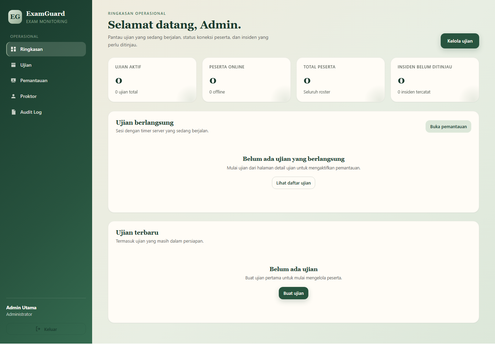
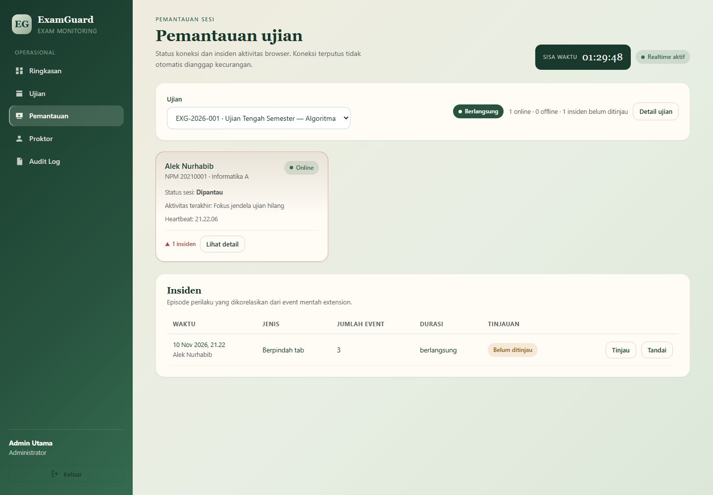

# ExamGuard

Web-based examination session & browser activity monitoring.
Backend **FastAPI** · Frontend **React + TypeScript + Vite** · Chrome Extension **MV3**.

Specification: `ExamGuard_Feature_Specification_v1.3.md` (product & engineering requirements v1.3).

---

## Repository layout

```
exam-guard/
├── backend/            FastAPI service
│   ├── app/
│   │   ├── api/        auth, exams, admin_users, monitoring, participant
│   │   ├── services/   exams, roster, participants, monitoring, reports, identity
│   │   ├── models.py   SQLAlchemy 2.0 ORM (SQLite + PostgreSQL portable)
│   │   ├── states.py   exam & participant state machines
│   │   ├── worker.py   server-authoritative expiry + heartbeat sweeper
│   │   └── main.py     application factory
│   ├── alembic/        migrations
│   └── tests/          pytest suite (68 tests)
├── frontend/           React dashboard + participant flow
├── extension/          Chrome MV3 monitoring extension
├── deploy/             nginx config, proxy includes
├── docs/               architecture, API, decisions, runbooks
├── Dockerfile          backend image
├── web.Dockerfile      frontend + nginx image
└── docker-compose.yml  PostgreSQL + API + web
```

---

## Quick start (local, SQLite)

```bash
# 1. Backend
cd backend
python -m venv .venv && .venv\Scripts\activate      # Windows
pip install -r requirements.txt
copy ..\.env.example .env
uvicorn app.main:app --reload --port 8000
```

```bash
# 2. Frontend (new terminal)
cd frontend
npm install
npm run dev            # http://localhost:5173
```

```bash
# 3. First-run setup
#    Open http://localhost:5173/setup
#    Setup secret comes from SETUP_SECRET in backend/.env
```

```bash
# 4. Extension
#    chrome://extensions → Developer mode → Load unpacked → select extension/
```

Local defaults in `.env.example` use `PARTICIPANT_IDENTITY_MODE=none`, so a
participant can register with **Exam ID + full name** only — no external login.

---

## Production (Docker + PostgreSQL)

```bash
cp .env.example .env
# Edit .env: set POSTGRES_PASSWORD, SECRET_KEY, SETUP_SECRET, PUBLIC_BASE_URL
docker compose up -d --build
docker compose exec api alembic upgrade head
```

Then open `https://exam.heda.my.id/setup` once and create the initial admin with
the `SETUP_SECRET` value. Setup disables itself permanently afterwards.

See `docs/DEPLOYMENT.md` for Cloudflare Tunnel, TLS, backups and the
`192.168.1.6` local-server profile.

---

## Core behaviour (as implemented)

| Requirement | Implementation |
|---|---|
| Exam access = Exam ID only | `POST /api/v1/participant/register` takes `exam_code`; no PIN/token exists anywhere in the schema |
| Identity = Exam ID + normalized name | `normalize_name()` = NFKC → casefold → strip all whitespace; exact key match only, no fuzzy matching |
| NPM informational only | No unique constraint, never compared during registration |
| Commitment checkbox | Re-validated server-side; version pinned to `COMMITMENT_VERSION`; timestamp generated by the server |
| Server-authoritative timer | `exam_sessions.started_at/ends_at` are set once by `start_exam()`; clients never submit time |
| Timer continues while offline | Deadline lives in the DB; `worker.sweep_once()` expires sessions regardless of client presence |
| Proctor scoping | Every exam-scoped route calls `require_exam_access()` → 403 when unassigned or permission missing |
| Audit trail | `record_audit()` on setup, auth, exam lifecycle, roster, incident review, exports |
| Data minimisation | Events store `page_host` only; full URLs and query strings are discarded |
| Disconnection ≠ cheating | `CONNECTION_LOST` is a connection state; it never creates an incident |

---

## Documentation

| Document | Contents |
|---|---|
| `docs/ARCHITECTURE.md` | Components, data model, state machines, realtime flow |
| `docs/API.md` | Endpoint reference with auth and permission notes |
| `docs/DECISIONS.md` | Deviations from the spec and the reasoning |
| `docs/DEPLOYMENT.md` | Docker, nginx, Cloudflare Tunnel, backups |
| `docs/RECOVERY.md` | Admin recovery, password reset, setup re-enable |
| `docs/TESTING.md` | Test layout and how to run it |
| `docs/ENV.md` | Every environment variable |

---

## UI preview

Screenshots of the running application are in `docs/screenshots/`
(17 screens: setup, login, dashboard, exam detail, participant flow,
monitoring, audit, mobile).




---

## Tests

```bash
cd backend
python -m pytest -q          # 75 tests
cd ../frontend
npm run typecheck
npm run build
```

End-to-end and WebSocket smoke scripts (need a running API):

```bash
cd backend
python e2e_smoke.py http://127.0.0.1:8000
python ws_smoke.py  http://127.0.0.1:8000
```
